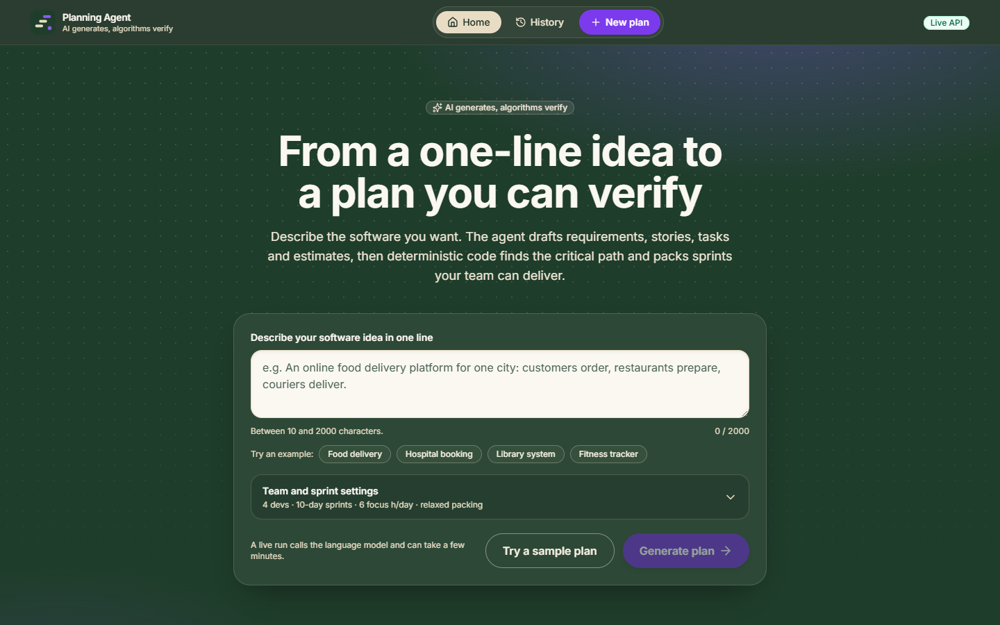
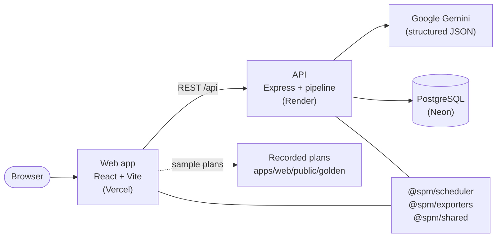
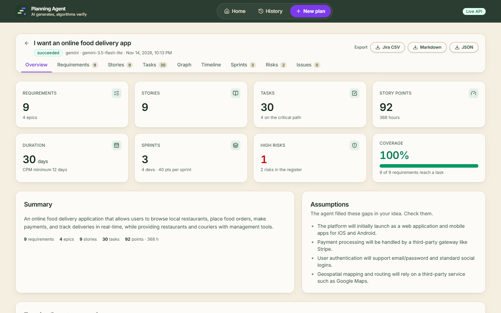
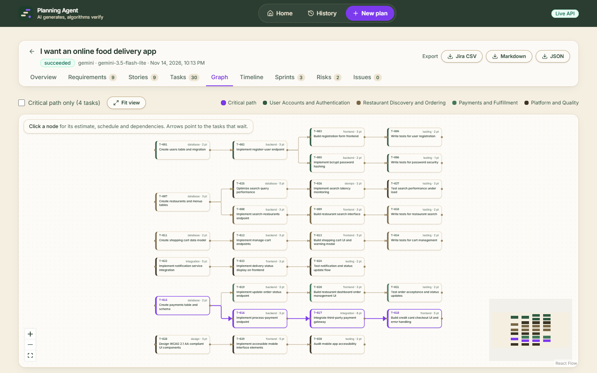
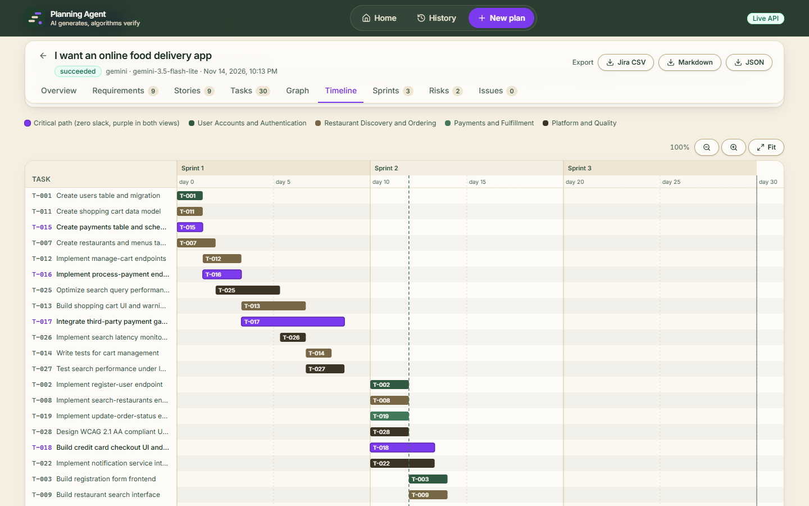
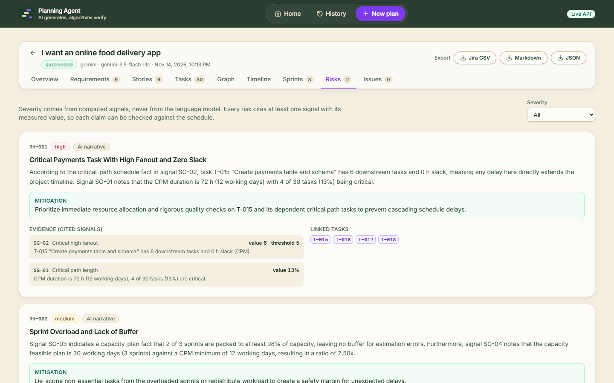

<div align="center">

# AI Software Requirement & Planning Agent

**Turn a one-line software idea into a traceable, schedule-consistent project plan**

[](https://github.com/Gokul-44/AI-Software-Requirement-Planning-Agent/actions/workflows/ci.yml)
[](https://ai-software-requirement-planning-ag-two.vercel.app)
[](.nvmrc)
[](tsconfig.base.json)

[Live demo](https://ai-software-requirement-planning-ag-two.vercel.app) · [Docs](docs/README.md) · [Report a bug](https://github.com/Gokul-44/AI-Software-Requirement-Planning-Agent/issues/new?template=bug_report.md)



</div>

## About

A client usually describes software in one sentence: "I want an online food delivery app". Turning that sentence into
requirements, stories, tasks, estimates, dependencies and a sprint schedule takes days of senior engineering time, and
two planners never produce the same plan. Tools such as Jira track a plan once it exists, but they do not create one.

This project takes the one-line idea and produces a **traceable, schedule-consistent plan** in roughly a minute and a half. Our rule
is **"AI generates, algorithms verify"**: a language model (Google Gemini) proposes the creative parts, then tested,
deterministic code checks every reference, rejects cycles, finds the critical path and packs the sprints. The plan can
be verified with arithmetic, not just read and believed.

## Key features

- 🔗 **Traceability:** every requirement links to stories and tasks; a coverage check shows what is missing.
- 🕸️ **Dependency graph with cycle detection:** unknown references and loops are caught by code, not guessed.
- 🎯 **Critical path:** computed with CPM in integer hours and highlighted in the graph and the Gantt chart.
- 📅 **Capacity-feasible sprints:** work is packed into sprints your team can really deliver.
- 🛡️ **Grounded risks:** severity is computed from numeric signals, and every risk cites the signals behind it.
- 🔮 **What-if planning:** change team size, velocity or packing mode and see the new schedule instantly in the browser.
- 📤 **Jira CSV and Markdown export** (plus the full plan as JSON).
- 🧰 **Sample-plan fallback:** recorded real plans open instantly, even when the AI quota or the API is unavailable.

## How it works

Eight stages. Stages in purple use the language model; stages in green are plain code.

```mermaid
flowchart LR
    I([One-line idea]) --> S1["1 Requirements"]
    S1 --> S2["2 Epics and stories"]
    S2 --> S3["3 Tasks"]
    S3 --> S4["4 Estimates"]
    S4 --> S5["5 Dependencies"]
    S5 --> S6["6 Validate, CPM,<br/>sprint packing, signals"]
    S6 --> S7["7 Risk narratives"]
    S7 --> S8["8 Assemble and export"]
    S8 --> P([Verified plan])

    classDef ai fill:#EDE9FE,stroke:#8B5CF6,color:#1F3D2B;
    classDef code fill:#DCFCE7,stroke:#1F3D2B,color:#1F3D2B;
    class S1,S2,S3,S4,S5,S7 ai;
    class S6,S8 code;
```



Every model answer is checked against a strict schema and the stage's rules (automatic repair retries if it fails). Code,
not the model, assigns identifiers, decides risk severity and computes the schedule. Details are in the
[design document](docs/design/design-document.md).

## Architecture



```text
.
├── apps/
│   ├── api/            Express API, pipeline, prompts, LLM providers, migrations
│   └── web/            React website
├── packages/
│   ├── shared/         Zod contracts (plan.json, API, config)
│   ├── scheduler/      graph, CPM, sprint packing and risk-signal algorithms
│   └── exporters/      Jira CSV and Markdown export
├── tests/e2e/          Playwright smoke test
├── eval/               evaluation ideas, rubric and measured results
├── fixtures/           sample plan inputs
├── scripts/            dev and build helper scripts
├── docs/               guides, design, evaluation, reference and screenshots
└── .github/            CI and deploy workflows, issue and pull request templates
```

## Tech stack

| Layer     | Technology                                           | Why                                                      |
| --------- | ---------------------------------------------------- | -------------------------------------------------------- |
| Language  | TypeScript (strict), npm workspaces                  | one language and shared types across the whole system    |
| Contracts | Zod                                                  | one schema validates model output, API and `plan.json`   |
| Web       | React 19, Vite, Tailwind CSS 4, TanStack Query       | fast development and a responsive, accessible UI         |
| Graph     | @xyflow/react with dagre, custom SVG Gantt           | readable dependency graph and timeline                   |
| API       | Node.js, Express                                     | small, well-known server with a simple async run model   |
| AI        | Google Gemini (free tier), mock and replay providers | real generation, plus offline and deterministic testing  |
| Database  | PostgreSQL on Neon                                   | durable runs and a stage cache on a free serverless tier |
| Testing   | Vitest, fast-check, Playwright                       | unit, property-based and end-to-end coverage             |
| Delivery  | GitHub Actions, Vercel, Render                       | automatic checks and deploys from `main`                 |

## Getting started

**Prerequisites:** Node.js 22.12 or newer (24 recommended, see [`.nvmrc`](.nvmrc)) and Git.

```bash
git clone https://github.com/Gokul-44/AI-Software-Requirement-Planning-Agent.git
cd AI-Software-Requirement-Planning-Agent
npm install
cp apps/api/.env.example apps/api/.env
```

**Run with the mock (no key needed):** a deterministic offline model and an in-memory store.

```bash
npm run dev:mock
```

Open <http://localhost:5173>.

**Run with Gemini:** edit `apps/api/.env`, set `LLM_PROVIDER=gemini`, `GEMINI_API_KEY` and `GEMINI_MODEL`, then either set
`DATABASE_URL` or `USE_MEMORY_DB=true`, and run:

```bash
npm run dev
```

More detail: [local setup guide](docs/guides/local-setup.md). Never commit the `.env` file.

## Scripts

| Script                                    | What it does                                                   |
| ----------------------------------------- | -------------------------------------------------------------- |
| `npm run dev`                             | API (settings from `apps/api/.env`) and website together       |
| `npm run dev:mock`                        | API with mock model and in-memory store, plus website          |
| `npm run dev:web` / `npm run dev:api`     | website only / API only                                        |
| `npm run build`                           | build all packages and the website                             |
| `npm run build:api`, `start:api`          | build and start the API (used by Render)                       |
| `npm run migrate:deploy`                  | apply database migrations (used by the deploy workflow)        |
| `npm test`                                | all unit and property-based tests                              |
| `npm run test:e2e`                        | Playwright smoke test on the mock stack                        |
| `npm run typecheck`                       | TypeScript check of every workspace                            |
| `npm run lint`                            | ESLint and Prettier check                                      |
| `npm run format`                          | format the repository with Prettier                            |
| `npm run eval`                            | run the evaluation against the real model (needs a Gemini key) |
| `npm run golden:record` / `golden:export` | record or export a sample plan                                 |
| `npm run fixture`                         | rebuild the test fixture and `docs/samples/jira-sample.csv`    |

Every workspace also has its own `build`, `test`, `typecheck` and `lint` scripts, for example `npm test -w @spm/scheduler`.

## Testing

- **Unit and contract tests** (Vitest): schemas, pipeline stages, prompts, exporters, UI helpers, 349 tests.
- **Property-based tests** (fast-check): 1,000 random dependency graphs of up to 150 tasks check the scheduler's
  invariants.
- **End-to-end smoke test** (Playwright): `npm run test:e2e` enters an idea on the mock stack, waits for the plan and
  checks the Jira CSV and Markdown downloads. It uses Playwright's Chromium, or the browser in `E2E_CHROMIUM_PATH`.

CI never calls a real model: it runs lint, typecheck, tests and build with the `replay` provider.

## Deployment

The website runs on **Vercel**, the API on **Render** and the database on **Neon**, all on free tiers. A push to `main`
runs the checks, applies migrations and triggers the API deploy through GitHub Actions. See the
[deployment guide](docs/guides/deployment.md).

## Screenshots

<table>
  <tr>
    <td width="50%"><br><sub><b>Overview:</b> key numbers, coverage and critical path</sub></td>
    <td width="50%"><br><sub><b>Graph:</b> validated dependencies, critical path in purple</sub></td>
  </tr>
  <tr>
    <td width="50%"><br><sub><b>Timeline:</b> sprint plan, CPM view and what-if panel</sub></td>
    <td width="50%"><br><sub><b>Risks:</b> every risk cites the signals behind it</sub></td>
  </tr>
</table>

## Team

All four members worked together on every part of the project: planning, design, development, testing, deployment and documentation.

| Avatar                                                                                                                   | Name                   | GitHub                                                          |
| ------------------------------------------------------------------------------------------------------------------------ | ---------------------- | --------------------------------------------------------------- |
| <a href="https://github.com/akshaykumartapraniya"></a> | Akshay Kumar Tapraniya | [akshaykumartapraniya](https://github.com/akshaykumartapraniya) |
| <a href="https://github.com/Gokul-44"></a>                         | Gokul Faleja           | [Gokul-44](https://github.com/Gokul-44)                         |
| <a href="https://github.com/saranshnaik"></a>                   | Saransh Naik           | [saranshnaik](https://github.com/saranshnaik)                   |
| <a href="https://github.com/Shreya-1511-tiwari"></a>     | Shreya Tiwari          | [Shreya-1511-tiwari](https://github.com/Shreya-1511-tiwari)     |

## Contributing

See [CONTRIBUTING.md](CONTRIBUTING.md) and the [Code of Conduct](CODE_OF_CONDUCT.md).
