# The whole project, explained simply

This is the master explanation of our project, the **AI Software Requirement and Planning Agent**. It is written for a
reader with no AI background. Every number in it comes from a file in this repository: the recorded real plans in
`apps/web/public/golden/`, the measured evaluation in `eval/results/`, the tests and the development log. If something
was not measured, we say so.

Final-year project, IIIT Vadodara, International Campus Diu. Team: Gokul Faleja, Saransh Sarang Naik, Akshay Kumar
Tapraniya and Shreya Tiwari. All four of us worked together on every part.

Contents:

1. [The problem](#1-the-problem)
2. [Our solution in one sentence](#2-our-solution-in-one-sentence)
3. [AI generates, algorithms verify](#3-ai-generates-algorithms-verify)
4. [The 8 stages, from idea to plan (food-delivery example)](#4-the-8-stages-from-idea-to-plan)
5. [The algorithms, in plain words (6-task example)](#5-the-algorithms-in-plain-words)
6. [How risks are grounded in computed signals](#6-how-risks-are-grounded-in-computed-signals)
7. [A page-by-page tour of the website](#7-a-page-by-page-tour-of-the-website)
8. [Tech stack and why we chose it](#8-tech-stack-and-why-we-chose-it)
9. [Safety and limits](#9-safety-and-limits)
10. [Results (measured)](#10-results-measured)
11. [Limitations](#11-limitations)
12. [Future scope](#12-future-scope)
13. [Glossary](#13-glossary)

---

## 1. The problem

A client usually describes software in one sentence, for example: "I want an online food delivery app".

Before a team can start building, someone has to turn that sentence into a real project plan:

- the **requirements** (what the software must do),
- **epics** and **user stories** (the features, written from the user's point of view),
- developer **tasks**,
- **estimates** (how big each task is),
- **dependencies** (which task must finish before another can start),
- a **schedule** split into **sprints**,
- and a list of **risks**.

Today this takes days of a senior engineer's time. Two planners given the same sentence produce two different plans,
and usually nobody can say which requirement a given task came from. Tools such as Jira are good at _tracking_ a plan
once it exists, but they do not _create_ one.

A general AI chatbot can write a plan-like text in seconds. But a text that sounds right is not
a plan that is right. Language models are good at writing and bad at arithmetic: they can invent task numbers that do
not exist, create loops ("A waits for B, B waits for A"), and give a timeline that does not add up.

## 2. Our solution in one sentence

You type a one-line idea, and in about a minute and a half you get a **traceable, schedule-consistent project plan**
that you can check with arithmetic, and that you can export to Jira (CSV) and Markdown.

- **Traceable** means every task links to a story, and every story links to the requirements it satisfies. Nothing
  floats around without a reason.
- **Schedule-consistent** means the timeline obeys every dependency and never puts more work into a sprint than the
  team can do.

## 3. AI generates, algorithms verify

This is the rule behind the whole design.

| Who            | What it does                                                                                                                                                                                      | Why                                                                     |
| -------------- | ------------------------------------------------------------------------------------------------------------------------------------------------------------------------------------------------- | ----------------------------------------------------------------------- |
| The AI (Gemini) | The creative writing: requirements, epics and stories, tasks, story-point estimates, which task depends on which, and the wording of the risks.                                                    | Language models are good at turning a vague idea into structured text. |
| Our code       | Everything that must be correct: gives every item its ID, checks every reference, removes bad links, finds loops, computes the critical path, packs the sprints, computes risk signals and severity. | Code is exact, tested and gives the same answer every time.            |

So the model **never** decides a schedule, a risk severity or a coverage number. Every model answer is checked against
a strict format (a "schema") before we use it, and if it is wrong we send it back with the list of errors and ask
again (up to 2 repair retries).

## 4. The 8 stages, from idea to plan

The pipeline has 8 stages. Stages 1 to 5 and 7 call the language model; stages 6 and 8 are pure code. After every
model stage our code checks the answer.

```mermaid
flowchart LR
    I([One-line idea]) --> S1["1 Requirements (AI)"]
    S1 --> S2["2 Epics and stories (AI)"]
    S2 --> S3["3 Tasks (AI, one call per epic)"]
    S3 --> S4["4 Estimates (AI + code)"]
    S4 --> S5["5 Dependencies (AI + code)"]
    S5 --> S6["6 Scheduling (code)"]
    S6 --> S7["7 Risks (code + AI)"]
    S7 --> S8["8 Assemble and export (code)"]
    S8 --> P([Verified plan])
```

We follow one real example all the way: the idea **"I want an online food delivery app"**, run with Google Gemini
(model `gemini-3.5-flash-lite`) and the default team settings (4 developers, 10-day sprints, 6 focus hours per day, 10
story points per person per sprint, 4 hours per story point). The recorded result is
[`apps/web/public/golden/food-delivery-gemini.json`](../../apps/web/public/golden/food-delivery-gemini.json). The whole
run took **76.2 seconds** and used **12,451 input tokens and 6,226 output tokens**.

### Stage 1: Requirement analysis (AI)

- **Goes in:** the idea text (10 to 2,000 characters). The idea is wrapped in markers and labelled as data, so text
  like "ignore your instructions" inside it is not obeyed.
- **Comes out:** a summary, a list of assumptions, and requirements, each marked functional or non-functional, with a
  priority (must, should, could).
- **Code then:** checks the format (5 to 25 requirements, at least one non-functional) and gives the IDs R-001,
  R-002 and so on. The model never chooses IDs.
- **Food example:** 9 requirements (6 functional, 3 non-functional) and 4 assumptions. For example R-001 "Users can
  create a new account using an email address and password" (must), R-007 "95% of search requests return results in
  under 500 ms" (performance), R-008 "All user passwords must be securely hashed using bcrypt before storage"
  (security). One assumption: "Payment processing will be handled by a third-party gateway like Stripe."
- **Why:** the assumptions make the gaps in a one-line idea visible, so the client can correct them.

### Stage 2: Epics and stories (AI)

- **Goes in:** the summary and the requirements with their R-codes (nothing else).
- **Comes out:** epics, each with user stories in the form "As a ..., I want ..., so that ...", 2 to 5 acceptance
  criteria per story, and the list of requirement IDs each story satisfies.
- **Code then:** rejects any reference to a requirement that does not exist, gives the IDs E-001 and S-001, and runs
  **coverage check C1**: every requirement must have at least one story. If one is missing, the model gets one
  targeted retry ("add stories for R-007"); if it is still missing, it is recorded as a warning. It is never hidden.
- **Food example:** 4 epics (User Accounts and Authentication; Restaurant Discovery and Ordering; Payments and
  Fulfillment; Platform and Quality) and 9 stories. Story S-001: "As a User, I want to create a new account using an
  email address and password, so that I can access the food delivery platform", with acceptance criteria such as
  "Given an existing email, when I register, then an error is shown." Coverage: 9 of 9 requirements have a story.
- **Why:** the story-to-requirement link is what makes the plan traceable.

### Stage 3: Task decomposition (AI, one call per epic)

- **Goes in:** one epic at a time, with its stories and their acceptance criteria.
- **Comes out:** developer tasks, each with a title, a description and a layer (frontend, backend, database, devops,
  testing, design or integration).
- **Code then:** checks that every task belongs to a story of that epic, merges the epics in order, gives the IDs
  T-001 and so on, and runs **coverage check C2**: every story must have at least one task. Limits: 1 to 8 tasks per
  story and at most 150 tasks in total.
- **Food example:** 4 calls (one per epic) gave **30 tasks**. Story S-005 (pay by credit card) got 4 tasks: T-015
  "Create payments table and schema" (database), T-016 "Implement process-payment endpoint" (backend), T-017 "Integrate
  third-party payment gateway" (integration) and T-018 "Build credit card checkout UI and error handling" (frontend).
- **Why one call per epic:** smaller answers are more reliable and do not get cut off.

### Stage 4: Effort estimation (AI + code)

- **Goes in:** the list of tasks (ID, title, layer, a short part of the story) and a fixed scale: "1 = trivial
  change, 2 = small unit, 3 = one endpoint or one screen, 5 = a feature slice touching 2 layers, 8 = a complex
  integration, 13 = too big and should be split".
- **Comes out:** story points for every task, from the set 1, 2, 3, 5, 8, 13, plus a one-line reason.
- **Code then:** checks that every task got exactly one estimate (a missing one gets a targeted retry), and converts
  points to hours with the team's table (default 4 hours per point: 1 = 4 h, 2 = 8 h, 3 = 12 h, 5 = 20 h, 8 = 32 h,
  13 = 52 h).
- **Food example:** 92 story points in total, which is **368 hours**. T-017 (payment gateway) got 8 points = 32 h.
- **Why:** the model judges size; the hours come from a table the team controls, not from the model.

### Stage 5: Dependencies (AI + code)

- **Goes in:** the compact task list (ID, title, layer, story, epic).
- **Comes out:** for each task, the tasks it "depends on", with a reason. We ask it this way ("T-016 cannot start until
  T-015 is finished") because "from/to" wording is easy to get backwards.
- **Code then:** turns each answer into a finish-to-start edge, **removes** edges that point to unknown tasks, edges
  from a task to itself and duplicates (each removal is logged as an issue), warns about edges that go against the
  usual layer order, and **checks for loops** (cycles). See section 5.
- **Food example:** **24 edges**, for example T-001 "Create users table" before T-002 "Implement register-user
  endpoint", reason: "Backend endpoint needs the users table." Result: **0 removed edges, 0 cycles.**
- **Why:** a schedule is only possible if the dependency graph has no loops and no dangling links.

### Stage 6: Scheduling (code only)

- **Goes in:** tasks, hours, edges and the team settings.
- **Comes out:** the critical path, the slack of every task, the sprint of every task and the sprint loads.
- **How:** see section 5 (CPM, priority order, sprint packing).
- **Food example:** the **critical path** is T-015 → T-016 → T-017 → T-018 (8 + 12 + 32 + 20 = **72 hours**, which is
  **12 working days** at 6 focus hours a day). Only 4 of 30 tasks are critical. With 4 developers × 10 points = **40
  points per sprint**, the work is packed into **3 sprints** with loads **40, 40 and 12 points**, which is **30 working
  days**. The ratio 30 / 12 = **2.50×** tells us the plan is limited by team size, not by dependencies.
- **Why:** this is pure arithmetic, so it is code. It runs in milliseconds and gives the same result every time.

### Stage 7: Risks (code + AI)

- **Goes in:** only the numeric **signals** our code computed from the schedule (section 6), never the model's own
  opinion.
- **Comes out:** risks with a title, a description and a mitigation, each citing at least one signal ID.
- **Code then:** rejects any risk that cites no signal or a signal that does not exist, and **sets the severity
  itself**: the highest severity among the cited signals. If no risk survives, code writes template risks from the
  signals, so the register is never empty and never invented.
- **Food example:** 4 signals and 2 risks. RK-001 (high) "Critical Payments Task With High Fanout and Zero Slack"
  cites SG-02 (T-015 has 6 downstream tasks and 0 h slack) and SG-01. RK-002 (medium) "Sprint Overload and Lack of
  Buffer" cites SG-03 (2 of 3 sprints packed to at least 98%) and SG-04 (ratio 2.50×).

### Stage 8: Assemble and export (code only)

- **Goes in:** everything above.
- **Comes out:** one `plan.json` file, checked against the plan schema and an integrity check (every ID that is
  referenced anywhere must exist). It is saved in one database transaction. From it the website shows the plan, and
  the exporters produce the **Jira CSV** and the **Markdown** document.
- **Food example:** requirements coverage 9 of 9, 0 issues.

**Caching:** every stage's answer is saved under a key made from the stage, the prompt version, the model, the
settings and the exact input. If the same input comes again, the saved answer is reused instead of calling the model.
When you only change team settings, only stages 6 to 8 run again.

## 5. The algorithms, in plain words

We explain every algorithm with one small example of 6 tasks. This exact example is a unit test in our code
(`packages/scheduler/test/e1-known-answer.test.ts`), so these numbers are checked on every build.

| Task | Points | Hours |
| ---- | ------ | ----- |
| A    | 2      | 8     |
| B    | 3      | 12    |
| C    | 2      | 8     |
| D    | 5      | 20    |
| E    | 1      | 4     |
| F    | 3      | 12    |

Dependencies (an arrow means "must finish before"): A → B, A → C, B → D, C → D, C → E, D → F, E → F.

### 5.1 Edge validation

Before any graph work, code throws away links that cannot be right: a link to a task that does not exist, a task
that depends on itself, and the same link twice. Each one becomes an entry on the Issues tab. Nothing is silently
dropped.

### 5.2 Is there a loop? (Kahn, then Tarjan)

A plan with a loop (A waits for B, B waits for A) can never be scheduled.

- **Kahn's algorithm** is the quick test: repeatedly take a task that waits for nothing, and remove it. If every task
  can be removed this way, there is no loop, and the removal order is a valid working order (a "topological order").
  Our 6 tasks pass.
- If Kahn gets stuck, the stuck tasks include the loop **and** every task that only waits behind the loop. Showing all
  of them would confuse the user. So we run **Tarjan's strongly connected components (SCC)** algorithm on the stuck
  tasks. It finds exactly the groups of tasks that wait for each other. Example from our tests: with A → B → C → A and
  C → D, the loop is exactly {A, B, C}, and D is reported separately as "blocked by the loop".
- **Repair policy:** (1) the model gets **one** chance to re-propose the links, but only for the tasks inside the loop;
  (2) if the loop is still there, the run stops with status "needs your decision" and the user ticks which link to
  remove; (3) every removed link is logged as an issue and becomes a risk signal. We never quietly delete a link.

### 5.3 Critical path (CPM)

The **Critical Path Method** finds the shortest possible project length if you had unlimited people. All arithmetic is
in whole hours.

- **Forward pass:** each task starts as soon as all its predecessors are done. A starts at 0 and ends at 8. B: 8 to 20.
  C: 8 to 16. D waits for B and C, so it starts at 20 and ends at 40. E: 16 to 20. F waits for D and E: 40 to 52.
- So the project needs **52 hours** at least.
- **Backward pass:** from the end, how late can each task start without delaying the end? The difference between the
  latest and the earliest start is the **slack**. C has 4 h of slack, E has 20 h, and A, B, D, F have 0.
- The tasks with zero slack form the **critical path: A → B → D → F** (8 + 12 + 20 + 12 = 52). If any of them slips,
  the whole project slips. The website draws them in purple.

### 5.4 Priority order

Many tasks can be ready at the same moment. To make the result fair and repeatable we always choose in this order:
**smallest slack first**, then **the task that unblocks the most later work**, then **the task ID**. For our example
the order is **A, B, C, D, E, F**. Shuffling the input gives exactly the same output (tested 25 times).

### 5.5 Sprint packing (strict versus relaxed)

Now the tasks go into sprints. Each sprint can hold at most C story points (C = team size × points per person).

**Strict packing** (the rule in our original project deck): a task may only go into a sprint _after_ the sprint of
every predecessor. With C = 10 points:

| Sprint | Tasks | Points |
| ------ | ----- | ------ |
| 1      | A     | 2      |
| 2      | B, C  | 5      |
| 3      | D, E  | 6      |
| 4      | F     | 3      |

That is **4 sprints for only 16 points of work**. A chain of 10 small tasks would need 10 sprints, which no real team
would accept. This was a flaw in the original design, and we fixed it.

**Relaxed packing** (our default): a task may share a sprint with its predecessor, as long as the predecessor finishes
first and the chain still fits into one developer's hours in that sprint (here H = 40 hours). With C = 10:

| Sprint | Tasks         | Points |
| ------ | ------------- | ------ |
| 1      | A, B, C, E    | 8      |
| 2      | D, F          | 8      |

That is **2 sprints instead of 4**. D does not fit into sprint 1 because 8 + 5 = 13 points is more than 10.

**The infinite-loop guard:** the original packing rule says "if the task does not fit, try the next sprint". If one
task is bigger than a whole sprint, that loop never ends. We made it impossible: the settings must allow a 13-point
task (C ≥ 13 points and sprint hours ≥ the hours of 13 points), and the packing function checks every task first and
throws a clear `OversizedTaskError` instead of looping. In the website, the settings form shows these two rules live.

**A surprise found by testing:** we expected relaxed packing to never need more sprints than strict packing. Our
property tests (1,000 random task graphs of up to 150 tasks) showed this is not always true: in about **1.4%** of random
graphs the greedy relaxed packing needs one more sprint. The smallest 4-task counterexample is kept in a test, and the
rule is now checked statistically. This is a known property of greedy packing, and we report it honestly.

### 5.6 What the website does with these

- The **Timeline** shows two views: the **sprint plan** (what your team can really deliver) and the **CPM** view (the
  lower bound with unlimited people). They differ on purpose: for the food example, 30 working days versus 12.
- The **what-if panel** runs the same scheduling code inside your browser. Change the team size and the sprints are
  recomputed instantly, with no model call.

## 6. How risks are grounded in computed signals

A "risk" written freely by a model is just an opinion. So our code first computes **signals**: measured facts about
the plan, each with a value, a threshold and a severity. There are 14 kinds. The ones in our real plans:

| Signal               | What it measures                                               | Severity rule (default)               |
| -------------------- | -------------------------------------------------------------- | ------------------------------------- |
| critical_path_length | share of tasks that are critical                               | at least 40% high, at least 25% medium |
| critical_high_fanout | a critical task with many tasks after it                       | 5 or more downstream tasks: high      |
| sprint_overload      | sprints packed to at least 98% of capacity (no buffer)         | medium at most, never high            |
| capacity_bound       | sprint-plan length divided by CPM length                       | 1.5× or more: medium                  |

Others include high fan-in (a task waiting for 4 or more tasks), isolated tasks, missing testing work, oversized
13-point tasks, suspected duplicate tasks and uncovered requirements.

The model only **explains** these signals in words and suggests a mitigation. Code rejects any risk without a valid
signal ID and computes the severity. On the Risks tab every risk shows its cited signals with the measured value, so a
reader can check each claim. Food example: RK-001 is high because it cites SG-02, whose value is 6 downstream tasks
against a threshold of 5.

## 7. A page-by-page tour of the website

The website has a header with **Home**, **History** and **New plan**, and a badge that says **Live API** when it is
connected to the server.

### Home (landing page)

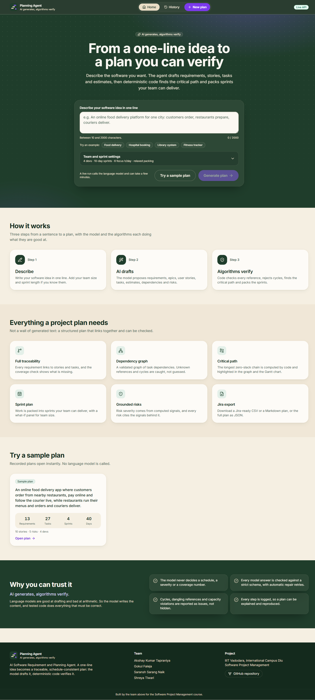

- The heading "From a one-line idea to a plan you can verify" and the idea box "Describe your software idea in one
  line" (10 to 2,000 characters, with a live counter).
- Example chips under "Try an example:": **Food delivery**, **Hospital booking**, **Library system**, **Fitness
  tracker**.
- **Team and sprint settings** (closed by default, showing "4 devs · 10-day sprints · 6 focus h/day · relaxed
  packing"): team size, velocity per person, sprint length, focus hours per day, the points-to-hours table, and
  Relaxed or Strict packing. Two live checks show whether a 13-point task fits.
- Buttons **Generate plan** and **Try a sample plan**, then the sections "How it works", "Everything a project plan
  needs", "Try a sample plan" (three recorded real plans) and "Why you can trust it".

### Run progress

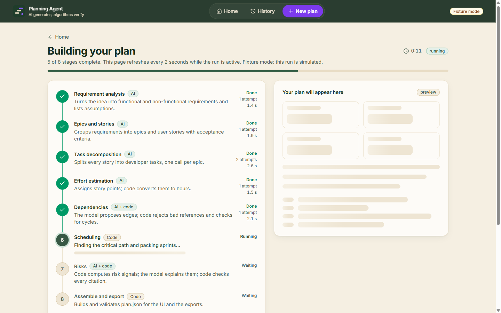

"Building your plan": the 8 stages with an **AI**, **AI + code** or **Code** badge, a status (Waiting, Running, Done,
Reused, Failed), attempts and time. The page refreshes every 2 seconds. When it finishes, the plan opens. (This
screenshot comes from the simulated mode, so its times are not real model times.)

If the model makes a loop that it cannot repair, the run pauses with "needs your decision" and shows the loop, with a
checkbox for each link and the button **Remove selected and continue**:

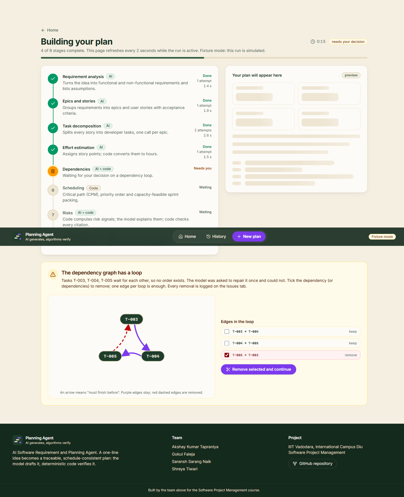

### Plan: nine tabs

The plan page has the idea as its title, the run status, the model used, an **Export** area (**Jira CSV**,
**Markdown**, **JSON**) and nine tabs.

- **Overview:** key number tiles (requirements, stories, tasks, story points, duration, sprints, high risks, coverage),
  the summary, the assumptions, "Two timelines, two questions" (CPM minimum versus the sprint plan and their ratio),
  effort by epic and by layer, the critical path and the run details.

  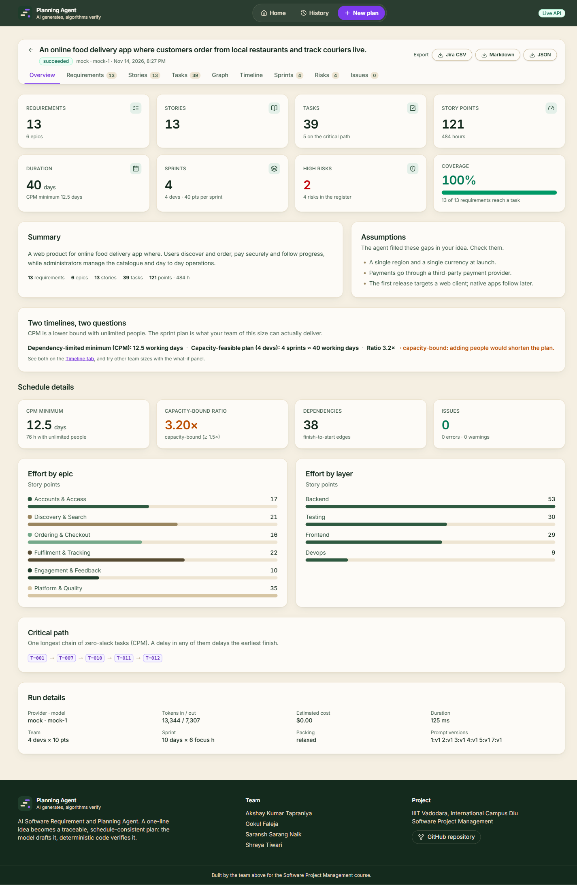

- **Requirements:** each requirement with its coverage ("Covered · 1 story · 4 tasks"), and a filter for coverage
  gaps.
- **Stories:** stories grouped by epic, with acceptance criteria, the requirements they satisfy and their tasks.
- **Tasks:** a sortable table (ID, task, epic, layer, points, hours, sprint, slack, critical). Clicking a task opens
  "Task details": estimate, CPM schedule, what it depends on, what it blocks, which requirement it traces to, and the
  risk signals that mention it.

  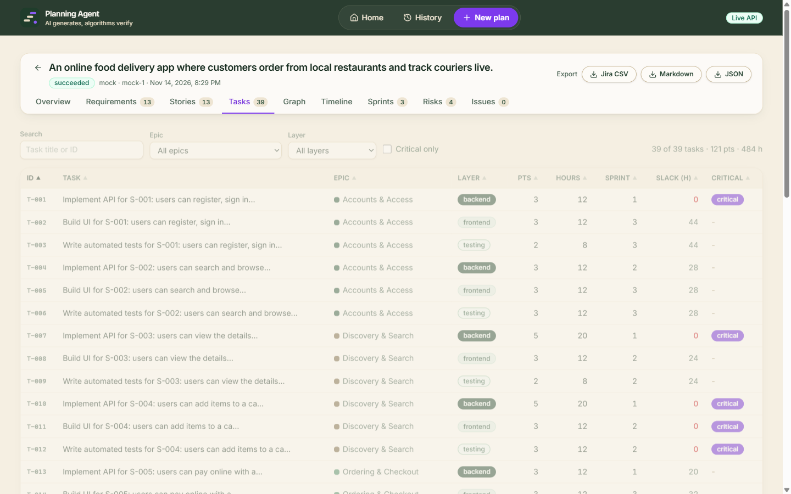

- **Graph:** the dependency graph, coloured by epic, critical path in purple, with "Critical path only" and "Fit view".

  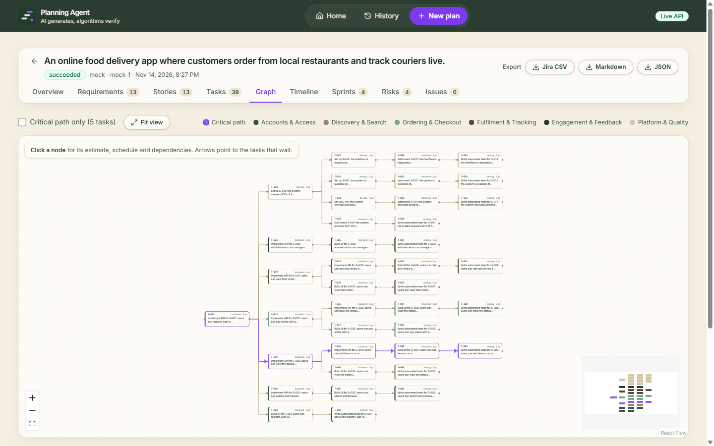

- **Timeline:** the Gantt chart with the toggle **Sprint plan (capacity)** / **CPM (unlimited people)**, and the
  **What-if** panel (team size, velocity, pack mode, a before and after table, **Reset to plan** and **Re-plan with new
  team settings**).

  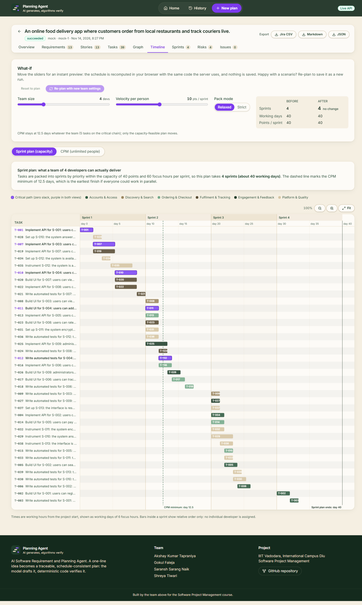

- **Sprints:** one card per sprint with its tasks and its load ("40 / 40 pts · 100%").
- **Risks:** each risk with severity, the AI-written text, the mitigation, "Evidence (cited signals)" with value and
  threshold, and the linked tasks.

  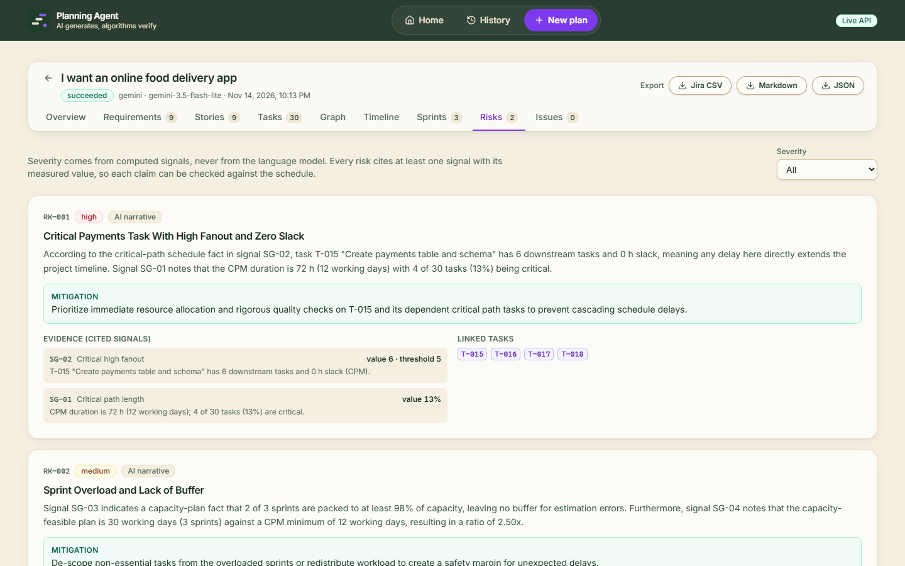

- **Issues:** everything code caught and logged (removed links, loops, coverage gaps, warnings). When there is nothing,
  it says "No issues found: every reference resolved, the graph is acyclic and every requirement is covered."

Some screenshots in this document (for example the Overview one, marked "mock · mock-1") were taken with the offline
mock model, so their numbers differ from the real Gemini plans described here. They show the layout, not results.

### History

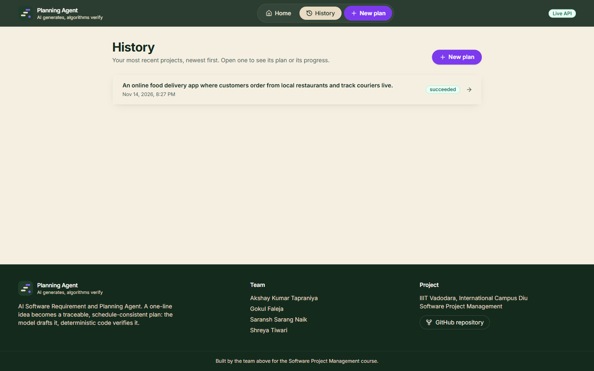

A list of recent projects, newest first, with their status. Open one to see its plan or its progress.

### Errors and phones

If the free AI quota is used up, the run page says "The free AI quota is used up right now" and offers **Retry from
stage N** and **Open a sample plan**. Other limits (too many runs, daily cap) show a friendly message and a button to
open a recorded plan. The site works at phone width (375 px) with no sideways scrolling; on a phone the export buttons
are in an **Export** menu.

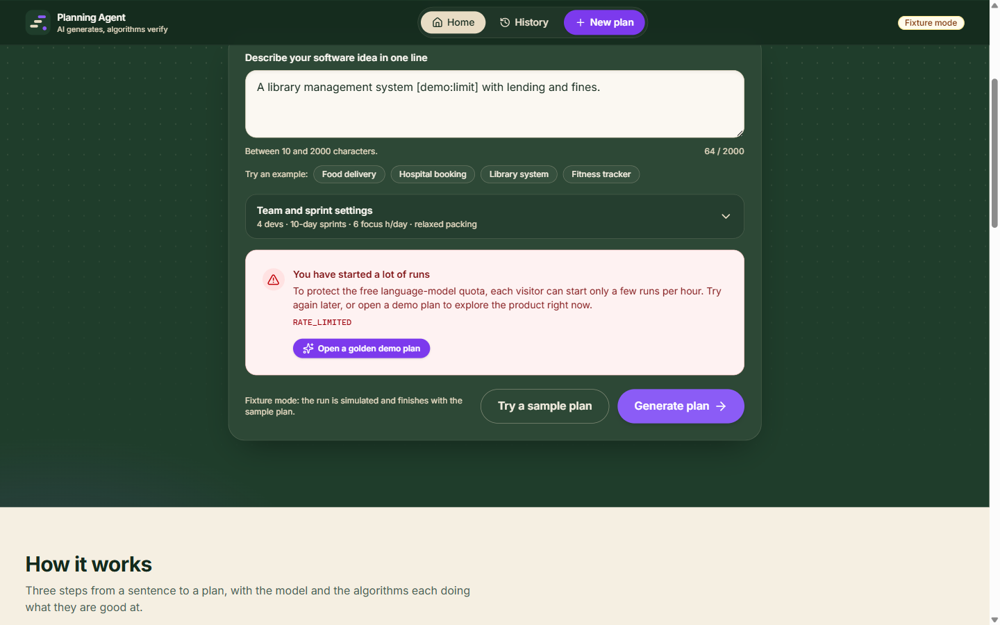

## 8. Tech stack and why we chose it

| Part                       | Technology                          | Why we chose it                                                                                                                                  |
| -------------------------- | ----------------------------------- | ------------------------------------------------------------------------------------------------------------------------------------------------ |
| Language                   | TypeScript everywhere               | One language for the website, the server and the algorithms, so they share the same types and the same scheduling code.                          |
| Website                    | React (with Vite, Tailwind CSS)     | Well known, fast to build with, good for interactive pages such as tabs, tables and the what-if panel.                                         |
| Dependency graph           | React Flow (with the dagre layout)  | Draws a readable, zoomable graph of tasks and arrows without writing a graph renderer ourselves.                                                |
| Server (API)               | Node.js with Express                | Small and simple. A run is started with one request and the browser checks its progress every 2 seconds.                                        |
| Data checks                | Zod                                 | One definition of each data shape checks the model's answers, the API messages and the final `plan.json`.                                      |
| AI model                   | Google Gemini (free tier)           | Free to use for a student project, and it can return JSON in a given format. Behind an interface, so a mock model and a replay model exist too. |
| Database                   | PostgreSQL on Neon                  | Standard SQL with foreign keys; Neon has a free serverless tier. Stores runs, every stage result, and the cache.                                 |
| Website hosting            | Vercel                              | Free, deploys a Vite site automatically, and serves the recorded sample plans even when the server is down.                                    |
| Server hosting             | Render                              | Free web service that runs Node.js as it is.                                                                                                     |
| Automation                 | GitHub Actions                      | On every push: lint, type check, tests and build. On `main`: database migration and the server deploy.                                         |
| Unit and property tests    | Vitest (and fast-check)             | Fast tests for TypeScript; fast-check generates 1,000 random task graphs to test the scheduler's rules.                                         |
| End-to-end test            | Playwright                          | Drives a real browser: enters an idea, waits for the plan, downloads the Jira CSV and Markdown and checks them.                                 |

The automated tests never call the real model: they use the mock or replay providers, so they are free and repeatable.
The test suite has 349 tests (3 database tests run only against a database).

## 9. Safety and limits

- **Free quota:** Gemini's free tier allows only a limited number of requests per minute and per day, per model. A full
  run needs about 9 model calls. The server leaves at least 6.5 seconds between two model calls.
- **Limits on the live site** (set in `render.yaml`): at most 3 new runs per hour per visitor, at most 15 live runs per
  day in total, and 1 run at a time. An optional access code can be required.
- **Friendly errors:** every error code has a plain message. If the quota is used up, the run page says so and offers
  "Retry from stage N" (finished stages are kept and not paid for again) and "Open a sample plan".
- **Sample plans:** three real plans made by Gemini are stored in the website itself, so they open instantly even when
  the quota is used up or the server is asleep. We changed these from a hand-written plan to real model output so that
  nobody can say the demo is fake.
- **Keys are never committed:** the Gemini key and the database address live only in the server's `.env` file (ignored
  by git) and in the hosting dashboards. The browser never talks to the model directly.
- **Untrusted text:** the model's text is shown as text (never as HTML), and CSV cells that start with `=`, `+`, `-` or
  `@` get an apostrophe so that Excel does not run them as formulas.

## 10. Results (measured)

We ran 10 fixed ideas through the real pipeline on 2026-11-15, plus the food-delivery idea two more times (13 runs in
total, cache turned off). Full results: [`eval/results/2026-11-15_gemini-3.5-flash-lite.md`](../../eval/results/2026-11-15_gemini-3.5-flash-lite.md).

**Honest note:** we planned to evaluate `gemini-3.6-flash`, but its free daily quota was used up, so the whole
evaluation used **`gemini-3.5-flash-lite`**. No result is claimed for any other model.

| What we measured                       | Result                                      |
| -------------------------------------- | ------------------------------------------- |
| Model answers valid on the first try   | 98.1% (105 of 107 calls)                    |
| Repair retries                         | 2 in 107 calls                              |
| Stages that failed after retries       | 0 of 98                                     |
| Invalid references                     | 0 of 688 proposed links                     |
| Loops (cycles) before repair           | 0 of 12 completed runs                      |
| Requirement coverage                   | 100% in every completed run                 |
| Duplicate tasks                        | 0%                                          |
| Tasks per story                        | 3.33 on average (2 to 5)                    |
| Dependency links per task              | 0.86                                        |
| Run time                               | 79.8 s on average, 106.9 s at most          |
| Same idea run 3 times: task count      | 26, 31, 26 (coefficient of variation 0.104) |
| Same idea run 3 times: CPM hours       | 52, 84, 52 (coefficient of variation 0.295) |

One run (idea 2) was cut off by a provider service error (HTTP 503) and was run again; both rows are kept.

The three recorded sample plans:

| Idea                                | Requirements | Stories | Tasks | Points | Links | CPM            | Sprints (4 devs) | Ratio | Risks | Run time |
| ----------------------------------- | ------------ | ------- | ----- | ------ | ----- | -------------- | ---------------- | ----- | ----- | -------- |
| I want an online food delivery app  | 9            | 9       | 30    | 92     | 24    | 72 h (12 days) | 3 (30 days)      | 2.50× | 2     | 76.2 s   |
| Hospital appointment booking system | 11           | 10      | 34    | 89     | 28    | 44 h (7.5 days) | 3 (30 days)     | 4.09× | 2     | 104.5 s  |
| An app to help farmers              | 6            | 6       | 19    | 52     | 16    | 64 h (10.5 days) | 2 (20 days)    | 1.88× | 3     | 96.4 s   |

For the vague farmer idea the model stated its assumptions, for example "Users will have intermittent internet
connectivity in rural fields, requiring offline data caching."

On the food-delivery sample plan the what-if panel gives (checked in the browser): 4 → 2 developers changes 3 sprints
(30 working days) to 5 sprints (50 working days); strict packing instead of relaxed changes 3 sprints to 4.

**Still pending (not done yet):**

- The human quality scores (`eval/rubric.md`, two raters per plan) have **not** been collected.
- The Jira CSV import into a real Jira site has **not** been tested; the mapping is unverified.
- No numbers exist for `gemini-3.6-flash` or any other model.
- The end-to-end browser test passes locally but is not part of the automatic CI checks.

## 11. Limitations

- **Free quota and speed:** live runs depend on Gemini's free tier, which limits requests per day and is slow (about 80
  seconds a run). On demo day the quota can run out.
- **One model evaluated,** and only the smaller Flash-Lite model.
- **Results vary between runs:** the same idea gave 52, 84 and 52 CPM hours in three runs. Within one run, the plan is
  fully consistent; across runs it changes.
- **No human quality scores yet,** and the Jira import is unverified.
- **Simple scheduling model:** one developer per task, finish-to-start links only, a fixed points-to-hours table (a
  setting, not learned from data), and start times inside a sprint are only indicative (we do not assign people).
- **Risk thresholds are assumptions** (for example "1.5× means capacity-bound"), not values learned from projects.
- **Sprint overload is common:** greedy packing fills sprints to the top by design, so most plans get one "no buffer"
  signal. We made it one medium signal, never high.
- **No user accounts:** the public site is protected by rate limits, a daily cap and an optional access code, not by
  login.
- **Free hosting sleeps:** Render's free server sleeps after about 15 minutes without traffic; the first request then
  takes about 50 seconds.
- The live loop-resolution flow was not exercised with the real model (the model never produced a loop in our runs);
  it is covered by tests and by the simulated mode.

## 12. Future scope

- Verify the Jira import on a real Jira site, then push plans directly to Jira through its API.
- Collect the human rubric scores and compare several models (including the originally planned one).
- Let users edit tasks and links in the website and re-schedule.
- A "split this task" action for 13-point tasks.
- Better estimates: ask for estimates several times and take the middle value, or learn the points-to-hours table from
  a team's past sprints.
- Probability-based schedules (Monte Carlo or PERT) instead of one fixed duration.
- Assign tasks to named developers, and add user accounts and team workspaces.
- A server-side guard that stops new runs while the quota is known to be used up.

## 13. Glossary

| Word                         | Meaning                                                                                                                                         |
| ---------------------------- | ----------------------------------------------------------------------------------------------------------------------------------------------- |
| Requirement                  | Something the software must do (functional) or a quality it must have, such as speed or security (non-functional). Our IDs: R-001.             |
| Functional / non-functional  | "Users can pay by card" is functional. "95% of searches answer in under 500 ms" is non-functional.                                             |
| Epic                         | A big feature area that groups several stories, for example "Payments and Fulfillment". IDs: E-001.                                             |
| User story                   | A small feature written as "As a [user], I want [goal], so that [reason]". IDs: S-001.                                                          |
| Acceptance criteria          | Testable conditions that say when a story is done, for example "Given an existing email, when I register, then an error is shown."            |
| Task                         | One piece of developer work, in one layer (frontend, backend, database, devops, testing, design, integration). IDs: T-001.                       |
| Story point                  | A relative size of work (1, 2, 3, 5, 8, 13). We convert points to hours with a table (default 4 h per point).                                    |
| Velocity                     | Story points one person finishes in one sprint (default 10).                                                                                     |
| Sprint                       | A fixed block of work time, here 10 working days.                                                                                               |
| Capacity (C)                 | Points a sprint can hold: team size × velocity (default 4 × 10 = 40).                                                                           |
| Sprint hours (H)             | One developer's working hours in a sprint: sprint days × focus hours (default 10 × 6 = 60).                                                      |
| Dependency (finish-to-start) | "Task A must finish before task B can start". Drawn as an arrow A → B.                                                                          |
| Graph, DAG                   | Tasks as dots and dependencies as arrows. A DAG (directed acyclic graph) is such a graph with no loops.                                          |
| Cycle (loop)                 | Tasks that wait for each other in a circle, so none can start.                                                                                  |
| Topological order            | A working order in which every task comes after all tasks it depends on.                                                                        |
| Kahn's algorithm             | Finds a topological order by repeatedly taking a task that waits for nothing; fails if there is a loop.                                           |
| SCC / Tarjan's algorithm     | A strongly connected component is a group of tasks that can all reach each other through arrows (a loop). Tarjan's algorithm finds these groups. |
| CPM                          | Critical Path Method: computes earliest and latest start and finish of every task, assuming unlimited people.                                   |
| Critical path                | The longest chain of dependent tasks. It sets the minimum project length. Any delay on it delays the project.                                   |
| Slack                        | How many hours a task can slip without delaying the project end. Critical tasks have zero slack.                                               |
| Fan-out, downstream tasks    | The tasks that come after a task, directly or indirectly.                                                                                        |
| Sprint packing               | Putting tasks into sprints in priority order without going over capacity. Strict: predecessors in earlier sprints. Relaxed: same sprint allowed. |
| Capacity-bound ratio         | Sprint plan length ÷ CPM length. Above 1.5× means more people would shorten the plan.                                                            |
| What-if panel                | A panel that re-runs the scheduler in the browser with other team settings, instantly and without saving.                                       |
| Signal                       | A measured fact about the plan, computed by code, with a value, threshold and severity. IDs: SG-01.                                             |
| Risk                         | A possible problem, written by the model, that must cite at least one signal. Severity is computed by code. IDs: RK-001.                        |
| Issue                        | Something code caught and logged, such as a removed link or a coverage gap. IDs: I-001.                                                         |
| Traceability, coverage       | Being able to follow requirement → story → task. Coverage is the share of requirements that reach a task.                                        |
| LLM                          | Large language model: an AI trained on a lot of text that writes text. We use Google Gemini.                                                    |
| Prompt                       | The instructions we send to the model for one stage. Ours are versioned files, for example `stage3.v2.md`.                                      |
| Token                        | A small piece of text (about part of a word) that models count for input and output.                                                            |
| Schema, Zod                  | A schema is an exact description of the allowed data shape. Zod is the library we use to check data against it.                                 |
| Repair retry                 | When a model answer breaks the schema, we send the errors back and ask for a corrected answer (up to 2 times).                                  |
| Cache, cache key             | A saved stage answer. The key is a hash of the stage, prompt version, provider, model, settings and exact input, so the same input reuses it.    |
| Mock / replay provider       | Fake model providers for testing: mock makes a plan offline for any idea; replay serves saved answers.                                          |
| Golden / sample plan         | A real plan recorded from Gemini and stored in the website, used as a demo and as a fallback.                                                   |
| Quota, rate limit            | How many model requests the free tier allows (per minute and per day), and how many runs our site allows per visitor.                          |
| API                          | The server part that the website calls (for example `/api/projects`, `/api/runs/:id`).                                                        |
| Jira CSV                     | A spreadsheet file in the format Jira's importer reads: epics, stories and sub-tasks with their links.                                          |
| Property-based test          | A test that generates many random inputs (here 1,000 random graphs) and checks rules that must always hold.                                     |
| CI                           | Continuous integration: automatic checks (lint, type check, tests, build) on every push, here with GitHub Actions.                              |
